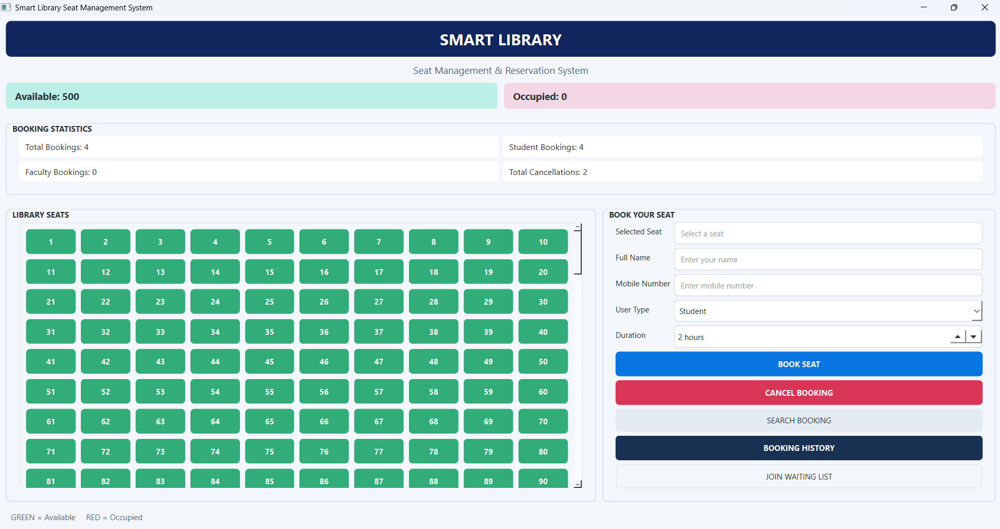

# Smart Library Seat Management System

## Application Preview

## About the Project
Smart Library Seat Management System is a C++ based application developed to manage library seats and reservations efficiently. It provides an easy way to book seats, cancel reservations, search bookings and maintain booking records.

The application is developed using Qt Creator with C++ and Qt Widgets.

## Features
- Management of 500 library seats.
- Seat booking and cancellation.
- Student and Faculty booking options.
- Search booking details using seat number.
- Automatic booking expiry.
- Booking history with clear history option.
- Waiting List management.
- Automatic seat assignment to waiting students.
- Booking statistics dashboard.
- Save and load booking details using text files.
- Scrollable seat layout.

## Technologies Used
- C++
- Qt Creator
- Qt Widgets
- CMake
- STL / Queue (FIFO concept)

## Data Structures
**Queue (FIFO):** The waiting list follows the First In First Out principle. The student who joins first gets the next available seat.

**Arrays:** Used to maintain seat booking information such as name, mobile number, user type and duration.

## Project Files
- `main.cpp` – Application entry point.
- `mainwindow.cpp` – Main application logic and functions.
- `mainwindow.h` – Class declarations and data members.
- `mainwindow.ui` – Qt user interface file.
- `CMakeLists.txt` – Project build configuration.

## How to Run
1. Open the project in Qt Creator.
2. Open `CMakeLists.txt`.
3. Configure the project using a compatible Qt kit.
4. Build the project.
5. Run the application.

## Storage
Booking information, statistics and booking history are stored in text files.

**Note:** The waiting list currently uses an in-memory queue and is not saved after the application closes.

## Project Purpose
The main purpose of this project is to demonstrate the practical implementation of C++, object-oriented programming and data structures in a library seat management application.
